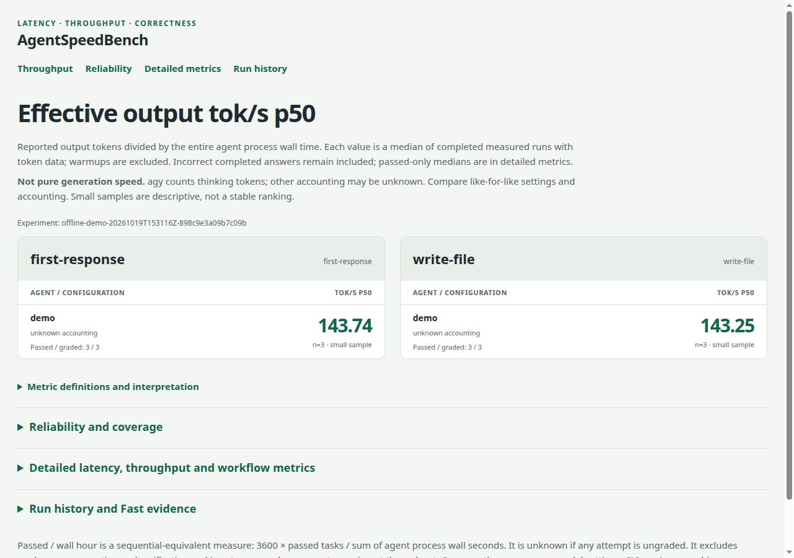

# AgentSpeedBench

[](https://github.com/poirotw66/agent-speed-bench/actions/workflows/ci.yml)

[English](README.md) · [繁體中文](README-tw.md)

Measures coding-agent latency, reported token throughput, tool intervals, and end-to-end correctness with a Go CLI.

[Results](docs/results.md) · [Usage & methodology](docs/guide.md) · [Measurement plan](docs/measurement-remediation-plan.md)

Inspired by [HarnessBench](https://github.com/nyosegawa/harness-bench); independent implementation (YAML, local repo snapshots, JSONL, SQLite, standalone HTML). No web service required.



## Headline results

Sequential 100 / 500 integer-output retest (2026-10-11). Harness commit `b2d2c674cd3754f1ae00a1e86145580cd8bae744`, `jobs: 1`, **n=3** per cell (small sample; descriptive only). Codex/Cursor isolated; agy used native login HOME. Effective tok/s = reported output tokens / full process wall time — not pure generation speed. Full tables, parallel run, and limitations: [docs/results.md](docs/results.md).

| Requested configuration | 100-line wall p50, s | 100-line effective tok/s p50 | 500-line wall p50, s | 500-line effective tok/s p50 |
| --- | ---: | ---: | ---: | ---: |
| GPT-6.1 Sol / medium | 9.76 | 21.20 | 19.39 | 51.92 |
| GPT-6 Luna / high | 7.69 | 29.64 | 12.41 | 83.51 |
| GPT-6 Luna / high / requested fast tier | 7.26 | 30.71 | 13.81 | 76.18 |
| Cursor Auto | 15.52 | 16.36 | 20.19 | 52.26 |
| AGY Gemini-3.8-Flash / low | 7.08 | 41.82 | 16.29 | 116.36 |
| AGY Gemini-3.8-Flash / medium | 6.21 | 47.66 | 13.73 | 138.13 |
| AGY Gemini-3.8-Flash / high | 8.48 | 51.30 | 15.19 | 145.93 |

All **42** measured samples and **14** warmups passed. AGY output accounting includes thinking; Codex/Cursor accounting is unknown. TTFA timing bases differ by adapter and are not interchangeable.

## Quick start

Requires Go 1.26+; runs on macOS and Linux.

```sh
go build -trimpath -o bin/agentspeedbench ./cmd/agentspeedbench
./bin/agentspeedbench run benchmarks/demo.yaml
```

The offline demo runs six synthetic attempts and writes `runs/<experiment>/report.html` (screenshot above). Timings and tokens are **fixtures for the harness**, not measurements of any AI service. The binary embeds SQLite.

```sh
./bin/agentspeedbench doctor benchmarks/quick.yaml
./bin/agentspeedbench run -jobs 1 benchmarks/quick.yaml
make check
make demo
```

Real `run` commands use installed agent CLIs and can consume quota. Authenticate each CLI separately first. Flags go before the YAML path. Details: [docs/guide.md](docs/guide.md).

## Architecture

```text
cmd/agentspeedbench    CLI and offline demo
internal/benchmark     Strict config and task contracts
internal/adapters      Vendor command/event differences
internal/runner        Scheduling, workspace, processes, grading
internal/telemetry     Normalized events and metrics
internal/storage       SQLite run records and JSON artifacts
internal/report        Statistics and standalone HTML
internal/responses     Response-only API streaming adapter
```

Adapters: `codex`, `claude`, `cursor`, `agy`, `generic`, `demo`, `openai-responses`. Metrics, YAML schema, verifiers, and resume/recovery: [docs/guide.md](docs/guide.md).

## Documentation

| Doc | Contents |
| --- | --- |
| [docs/results.md](docs/results.md) | Native measurement tables, commit pins, sample sizes, Keychain notes |
| [docs/guide.md](docs/guide.md) | CLI reference, adapters, metrics, YAML, artifacts, real Go cases |
| [docs/measurement-remediation-plan.md](docs/measurement-remediation-plan.md) | Scope boundaries and validation record |

Engineering fixtures use independently written tests. The real Go case exercises [lazygit PR #5495](https://github.com/jesseduffield/lazygit/pull/5495); upstream lazygit is MIT licensed.

## License

MIT © 2026 poirotw66. See [LICENSE](LICENSE).
